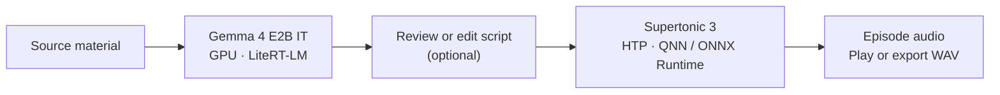

# Qoralo

Qoralo is an Android prototype that turns source material into a script and narrated audio using models running on the phone. The current target is a **Galaxy S23 Ultra** with Snapdragon 8 Gen 2.

**[App source and status](podcast-app/README.md)** · **[Setup guide](podcast-app/docs/getting-started.md)** · **[Visual article draft](docs/qoralo-blog/index.html)** · **[Presentation](docs/presentation/index.html)**

## From sources to an episode

Import source material, give the app instructions, then review or edit the generated script before creating audio. The app has a library, persistent player, WAV export and episode diagnostics/deletion. Script review can also be turned off.



Gemma writes the script on the GPU. Supertonic generates speech on Qualcomm's **Hexagon Tensor Processor (HTP)**, the phone's NPU route. The CPU still runs the app, prepares model inputs and manages audio files. These are the selected model routes, not a claim that every operation runs on an accelerator or that both models run simultaneously.

Long narration follows Supertonic's recipe: process shorter pieces separately, then assemble the audio. The app keeps complete chapters and a final episode WAV; it does not silently switch to a CPU model if a route fails.

## Prototype status

- The app is developed for the **SM8550 / HTP V73** target above, not validated across Android phones generally. It is not a public app release.
- Earlier phone runs established real GPU script generation and HTP speech generation. The **latest frozen app is host-tested, not newly device-tested**; the final normal UI-to-audio demo and listening review remain pending. See the [current closeout and exact build identities](podcast-app/docs/current-closeout.md).
- Experimental recordings are not samples of the current app's output. [Writing-quality observations](podcast-app/promptlab/README.md) and [remaining historical test failures](podcast-app/docs/host-scope-test-baseline.md) are recorded separately.

## Build and run

Start with the **[setup guide](podcast-app/docs/getting-started.md)** for prerequisites, local artifacts and licensing constraints. The [app README](podcast-app/README.md) links the build commands, runtime routes and delivery runbook.

A clone alone is not a runnable neural deployment. Model weights, prepared context files and licensed native runtime libraries must be provisioned separately; they are not supplied by this repository. APKs and large local build/model artifacts remain outside Git.

## Read the article and presentation locally

The links above open **HTML source on GitHub**, not hosted pages. No public article destination has been chosen. After cloning, serve the repository root:

```bash
python3 -m http.server 8766 --bind 127.0.0.1
```

Then open:

- **[Visual article draft](http://127.0.0.1:8766/docs/qoralo-blog/)**: the private visual write-up. Moritz is still revising its prose.
- **[Presentation](http://127.0.0.1:8766/docs/presentation/)**: the model choices, GPU/NPU architecture and speech deployment work, with optional technical detail.

Keep the repository's relative files together so diagrams, recordings and evidence links resolve. Any audio on those pages is labelled experimental evidence, not a current-app demo.

## Research and evidence

The app grew out of model and accelerator experiments. This repository keeps that research alongside the app, including failed attempts; it is still named `vibevoice-android-spike` for historical reasons. The active app uses Gemma and Supertonic, not VibeVoice.

| Start here | Contents |
| --- | --- |
| [Experiments](experiments/) | Numbered investigations, tools, measurements and limitations |
| [History](docs/history.md) and [plan](docs/plan.md) | Completed work and unfinished research |
| [Wiki](docs/wiki/README.md) | Model, runtime and hardware explanations |
| [Speech deployment reconstruction](docs/supertonic-android-htp-reconstruction.md) | The recorded steps from speech models to Android HTP execution |
| [TTS benchmarks](docs/android-benchmarks/) | Speech measurements and listening records |
| [LLM benchmarks](docs/android-llm-benchmarks/) | Separate language-model execution and performance evidence |
| [TTS protocol](protocols/android-tts-benchmark/) and [LLM protocol](protocols/android-llm-benchmark/) | Workloads, measurement rules and required evidence |

Component benchmarks, host tests, phone runs and complete app workflows support different claims. Their records retain that distinction; an accepted recording does not turn a failed numerical comparison into a pass.
